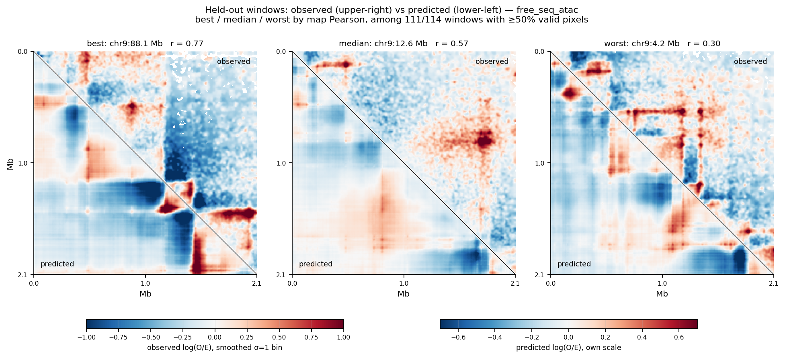
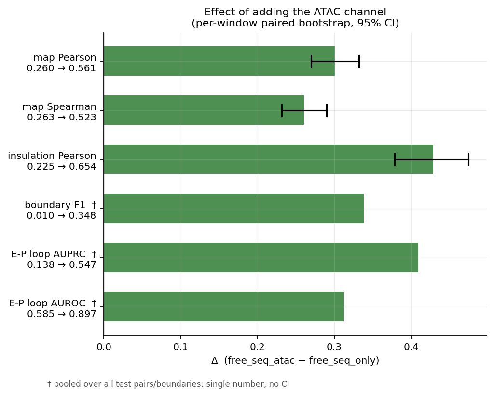
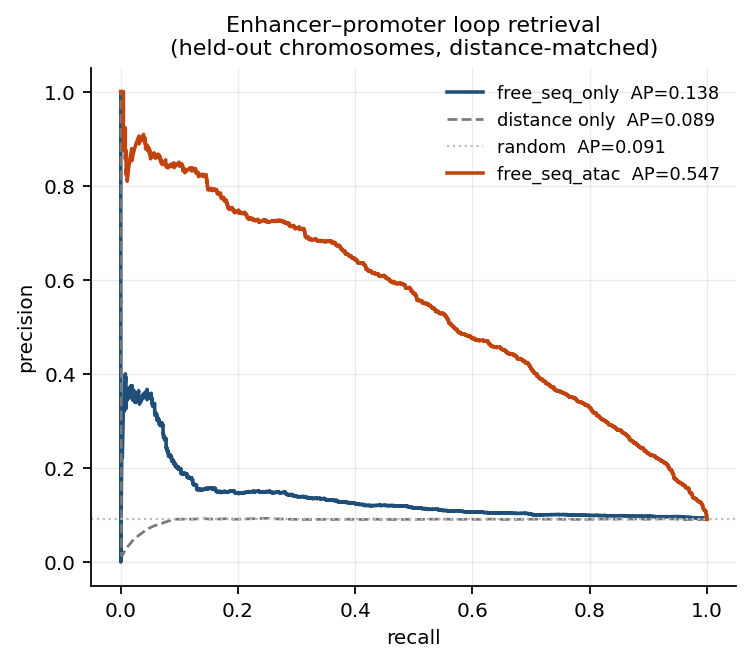
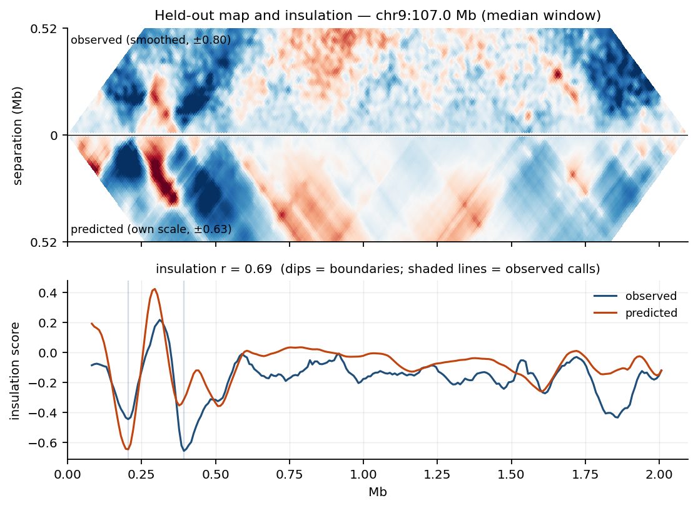

# seq2hic-gm12878

Predicting GM12878 chromatin contact maps from DNA sequence, and measuring how much
chromatin accessibility actually adds.

Two models are trained on identical windows, splits, targets and schedules. The only
difference is the input:

| arm | input | question it answers |
|---|---|---|
| **A** `seq_only` | one-hot DNA (4 × 2,097,152) | how far does sequence alone get you? (Akita-style) |
| **B** `seq_atac` | one-hot DNA + ATAC signal (5 × 2,097,152) | does measured accessibility carry information sequence does not? (C.Origami-style) |

The contribution is the **delta**, not either model on its own: ΔPearson on held-out
contact maps, Δinsulation-score correlation, and ΔAUPRC on enhancer–promoter loop
retrieval over held-out chromosomes.


**Result (held-out chr9 + chr10, 114 windows of 2 Mb):** adding the ATAC channel raises
contact-map Pearson from **0.26 to 0.56** (Δ +0.30, 95% CI [0.27, 0.33]) and
enhancer–promoter loop AUPRC from **0.14 to 0.55** (distance-only baseline 0.09).
One training run per arm on free Kaggle GPUs; see [Results](#results) for caveats.



---

## Data

Both datasets are GM12878, so the accessibility channel is a genuine matched input
rather than a proxy from another cell type.

| accession | assay | lab | role |
|---|---|---|---|
| [ENCSR830NVY](https://www.encodeproject.org/experiments/ENCSR830NVY/) | Hi-C | Aiden, Baylor (series ENCSR392PEL) | **target** — 2D contact map |
| [ENCSR637XSC](https://www.encodeproject.org/experiments/ENCSR637XSC/) | ATAC-seq | Snyder, Stanford (ENCODE4) | **input channel** (signal bigWig) + **enhancer definition** (IDR peaks) |

Auxiliary: GRCh38 primary assembly FASTA, GENCODE TSS annotation.

File URLs are **not hardcoded**. `python -m seq2hic.encode list ENCSR830NVY` queries the
ENCODE REST API and prints every released file with its `output_type`, `file_format`
and assembly, so you pick against ground truth rather than against a stale URL.

---

## Representation

* **Window**: 2,097,152 bp (2^21), stride 262,144 bp during training, non-overlapping at eval.
* **Output grid**: 256 × 256 bins ⇒ **8,192 bp per bin** (2^21 / 2^8).
* **Target transform**: balanced counts → observed/expected against a per-chromosome
  diagonal-decay curve → `log` → clip to ±2 → symmetrize. The first two diagonals are
  masked out of the loss (they are dominated by ligation artefacts).
* **Resolution handling**: ENCODE matrices are stored at standard resolutions (1/5/10 kb),
  not 8,192 bp. Windows are read at the finest available native resolution and
  **area-resampled** onto the 8,192 bp grid. The resampling is exact area-weighted
  averaging, not interpolation — see `targets.py::area_resample`.
* **ATAC channel**: fold-change-over-control bigWig, `log1p`, base-pair resolution,
  concatenated as a fifth input channel.

---

## Model

A pure dilated CNN — no attention, no recurrence.

```
one-hot (+ATAC)  (B, 4|5, 2_097_152)
  └─ stem conv k=11
  └─ 13 × [conv k=5 → BN → GELU → maxpool 2]      2^13 = 8192 bp per bin
  └─ 4 × dilated 1D residual blocks (d = 1,2,4,8)
  └─ 1×1 conv → C1 = 96                            (B, 96, 256)
outer concat: broadcast i and j, + log-distance channel
                                                   (B, 193, 256, 256)
  └─ 1×1 conv → C2 = 48
  └─ 8 × dilated 2D residual blocks (d = 1,2,4,…,128), symmetrized
  └─ 1×1 conv → 1, symmetrize                      (B, 256, 256)
```

Loss: MSE over the upper triangle with `|i-j| >= 2`.

**The block count is not arbitrary.** Each output bin must be able to see both of its
own anchors, so the 2D receptive field has to cover the whole window. With dilations
doubling from 1, `n` blocks reach `1 + 2·(2ⁿ − 1)` bins:

| blocks | receptive field | covers 2.10 Mb window? |
|---|---|---|
| 6 | 127 bins = 1.04 Mb | ✗ |
| 7 | 255 bins = 2.09 Mb | ✗ (just short) |
| **8** | **511 bins = 4.19 Mb** | ✓ |

`figures/fig7_receptive_field.png` is generated from the config and states plainly
whether the current setting covers the window — regenerate it after changing depth,
window size or resolution.

---

## Splits

Chromosome holdout — no window from a test chromosome is ever seen in training, and
windows are cropped so they cannot straddle a split boundary.

```
train  chr1–4, 6, 7, 11–13, 15–22
val    chr5, chr14
test   chr8, chr9, chr10
```

chrX, chrY, chrM and unplaced contigs are excluded. Configurable in `configs/base.yaml`.

---

## Quickstart

```bash
pip install -r requirements.txt

# 0. see what ENCODE actually has for these accessions
python -m seq2hic.encode list ENCSR830NVY
python -m seq2hic.encode list ENCSR637XSC

# 1. download (writes to data/raw, resumable, md5-checked)
python -m seq2hic.encode fetch ENCSR830NVY --output-type "mapping quality thresholded contact matrix"
python -m seq2hic.encode fetch ENCSR637XSC --output-type "fold change over control" --file-format bigWig
python -m seq2hic.encode fetch ENCSR637XSC --output-type "IDR thresholded peaks" --file-format bed
python -m seq2hic.encode genome            # GRCh38 FASTA + GENCODE TSS

# 2. materialise tensors once (targets, ATAC memmaps, window index)
python -m seq2hic.prepare --config configs/base.yaml

# 3. train both arms
python -m seq2hic.train --config configs/seq_only.yaml
python -m seq2hic.train --config configs/seq_atac.yaml

# 4. evaluate + ablation table
python -m seq2hic.evaluate --config configs/seq_only.yaml --split test
python -m seq2hic.evaluate --config configs/seq_atac.yaml --split test
python -m seq2hic.ablation --runs runs/seq_only runs/seq_atac
```

A CPU smoke test that exercises the whole path on synthetic data in about a minute:

```bash
pytest -q                      # shape + invariance tests
python -m seq2hic.train --config configs/smoke.yaml
```

---

## Platform notes

* **`pyBigWig` has no Windows wheel.** `tracks.py` therefore supports three backends —
  `pyBigWig`, the UCSC `bigWigToBedGraph` binary, or a pre-converted `.npy` — and the
  conversion happens once in `prepare`, so the training loop itself needs only numpy.
  On Windows the practical route is the UCSC binary; on Linux/WSL, `pyBigWig`.
* **`.hic` vs `.mcool`.** `cooler` is the first-class path (pure Python, works on Windows).
  `hicstraw` is optional and used only if ENCODE released `.hic` and not `.mcool`.
* **Training is GPU work.** A 2 Mb window at bp resolution through a 13-stage conv tower
  is roughly 11 GB of activations at batch size 1 in fp32. Use `--amp` and expect to want
  ≥24 GB VRAM, or reduce `window_bp` to 2^20 and `n_bins` to 128 for a smaller study.
  The torch install on this machine is CPU-only (`2.10.0+cpu`) — fine for `smoke.yaml`,
  not for a real run.

---

## Layout

```
configs/            base + per-arm + smoke configs
src/seq2hic/
  encode.py         ENCODE REST discovery, resumable download, md5 verification
  genome.py         FASTA → one-hot, chromosome sizes, N-masking
  tracks.py         bigWig → per-chromosome float16 memmap
  targets.py        cooler/hic → O/E log windows on the 8,192 bp grid
  prepare.py        one-shot dataset materialisation
  dataset.py        window index, splits, torch Dataset
  model.py          trunk, outer concat, dilated 2D head
  train.py          loop, AMP, checkpointing, early stop
  metrics.py        map correlation, insulation score, boundary F1
  ep_loops.py       enhancer–promoter pair construction + AUPRC
  evaluate.py       per-chromosome eval report
  ablation.py       arm A vs arm B delta table
tests/
```

---

## Figures

Two kinds, kept strictly apart so nothing can be mistaken for a result.

**Design figures** — generated from the config alone, no training required, and
committed to `figures/`:

```bash
python -m seq2hic.architecture_fig --config configs/seq_atac.yaml --out figures
```

| | |
|---|---|
| `fig0_architecture.png` | full data flow, every number read from the config |
| `fig7_receptive_field.png` | dilation schedule; states whether the 2D stack covers the window |
| `fig8_target_transform.png` | raw counts → balanced → coarse-grained → detrended log(O/E) |


Panel 4 is the point of the whole transform: distance decay is gone, and what
remains is the off-diagonal loop structure the model is actually asked to predict.

**Result figures** — produced from a trained run and committed to `figures/`
(per-arm figures carry the arm name as a prefix):

```bash
python -m seq2hic.figures --runs runs/free_seq_only runs/free_seq_atac --split test --bin-bp 8192 --out figures
```

| | |
|---|---|
| `<arm>_fig1_contact_maps.png` | one square per window, observed upper-right (smoothed σ = 1 bin for display), predicted lower-left on its own colour scale; best / median / worst held-out windows among those with ≥ 50% valid pixels |
| `<arm>_fig2_insulation.png` | rotated observed/predicted maps above the insulation profiles, with observed boundary calls |
| `fig3_training_curves.png` | loss (log scale) and validation correlation, both arms |
| `fig4_ep_pr_curve.png` | E–P precision-recall vs the distance-only baseline |
| `fig5_ablation.png` | per-metric Δ with paired bootstrap CIs (pooled metrics marked †) |
| `<arm>_fig6_distance_decay.png` | accuracy as a function of genomic separation |

Predicted maps are drawn on their own scale because an MSE-trained model shrinks its
output toward zero; on the observed scale its structure would be invisible. The scale
is printed on the colour bar. The figure code also flags a model that emits the same
map for every window (prediction spread across windows < 5% of the data's), which is
how the broken seq-only arm of run v5 showed up.

`fig6` is the honesty check: a high overall correlation carried entirely by
short-range contacts, with long-range structure at chance, is the classic way
this class of model looks better than it is.

`figures_smoke/` holds the same figures from the **synthetic** CPU smoke run.
They demonstrate the plumbing works and nothing more — see the README in that
directory.

---

## Reporting

`ablation.py` emits a markdown table and `ablation.json` (filled-in numbers under [Results](#results)).

Deltas use a **paired** bootstrap over windows — both arms are evaluated on the identical
window list, so pairing cancels the shared between-window variance and gives a much
tighter interval than comparing two independent CIs.

Three reference points are reported alongside the E–P AUPRC, because the number is
meaningless without them:

- **random** = the positive rate (AUPRC's baseline *is* the positive rate),
- **distance-only** = scoring pairs by `−distance`; a model that fails to beat this has
  learned distance decay and nothing else, whatever its map correlation says,
- **observed-map ceiling** = scoring with the true map, i.e. the best achievable given
  how the labels were defined.

## Status

The pipeline runs end to end and is verified by 37 tests plus a synthetic CPU smoke run
(`prepare → train both arms → evaluate → ablation → figures`). A CPU preflight kernel
pushes every train and validation window through the real loader before any GPU run.

## Results

Run **v6** (2026-11-22, commit `eea9222`, Kaggle 2× T4, configs `free_seq_only` /
`free_seq_atac`, both arms trained in parallel for the full 20 epochs, ~5.6 h).
Test = chr9 + chr10, 114 held-out 2 Mb windows. Δ = paired bootstrap over windows,
1000 resamples. Raw tables: [`results/v6/`](results/v6/).

| metric | seq-only | seq+ATAC | Δ (95% CI) |
|---|---|---|---|
| map Pearson | 0.260 | 0.561 | +0.301 [0.270, 0.332] |
| map Spearman | 0.263 | 0.523 | +0.260 [0.232, 0.290] |
| insulation Pearson | 0.225 | 0.654 | +0.429 [0.378, 0.475] |
| boundary F1 † | 0.010 (P 0.09 / R 0.01) | 0.348 (P 0.45 / R 0.28) | +0.338 |
| E–P loop AUPRC † | 0.138 | 0.547 | +0.410 |
| E–P loop AUROC † | 0.585 | 0.897 | +0.313 |

† pooled over all test boundaries / pairs: a single number, no interval.
E–P: 16,918 distance-matched pairs, 1,538 positive. Reference points: random = 0.091
(positive rate), distance-only = 0.089 AUPRC / 0.499 AUROC.







**What this does and does not show**

- Both arms learned. Sequence alone recovers real structure on unseen chromosomes
  (map r = 0.26; E–P AUPRC 0.14 against a 0.09 distance baseline). Adding the matched
  GM12878 ATAC track roughly doubles map accuracy, nearly triples insulation accuracy, and quadruples E–P
  AUPRC. Every per-window CI excludes zero.
- **One run per arm.** There is no seed-to-seed spread yet, so the Δ's CI reflects
  window sampling only, not training variance.
- **Both arms hit the 20-epoch cap** without early stopping. seq+ATAC had flattened
  (val r 0.567 → 0.568 over the last four epochs); seq-only had too (0.278). Longer
  training is unlikely to change the ordering but could shift the numbers.
- **Not comparable to published numbers.** Akita and C.Origami use different window
  sizes, resolutions, targets and far more compute. These numbers compare the two arms
  here, under identical conditions, and nothing else.
- **E–P labels come from the observed map** (the observed-map ceiling is AUPRC 1.0 by
  construction), and enhancers are defined from ATAC peaks. The ATAC arm therefore sees
  accessibility at exactly the anchors it is scored on. That is legitimate (it is the
  question the ablation asks) but it is part of why the E–P gap is the largest.
- Predicted maps show faint row/column streaks, most likely ATAC peaks propagated
  directly into the map. They are visible in `fig1` and left in rather than smoothed
  away.

**Run history** (kept so the numbers above can be trusted for the right reasons)

- **v4**: both arms crashed. Forked DataLoader workers shared one pyfaidx handle and
  raced on its seek offset, producing wrong-length (and possibly wrong-base) reads.
  Fixed in `95cc1a6` (FASTA reopened per process, strict length check).
- **v5** (`bb2568d`): seq+ATAC map r 0.334, E–P AUPRC 0.192. The seq-only arm
  **diverged** (val loss 0.12 → 1.34 → 7.61 at epochs 3–5) and output the same map for
  every window, so that run's ablation was not fair. The cause was BatchNorm at batch
  size 1: running statistics were corrupted and eval-mode outputs blew up. Replaced
  with GroupNorm in `eea9222`. seq+ATAC also improved in v6 (0.33 → 0.56); v6 differs
  from v5 in normalisation and in training the full 20 epochs, so the gain is not
  attributed to either change alone.
- Boundary F1 read 0 for both arms in v5 because boundaries were called with an
  absolute prominence cut that shrunk MSE predictions never reached. Boundaries are
  now called on each window's z-scored insulation profile (`68b88ec`).

## License

MIT.
