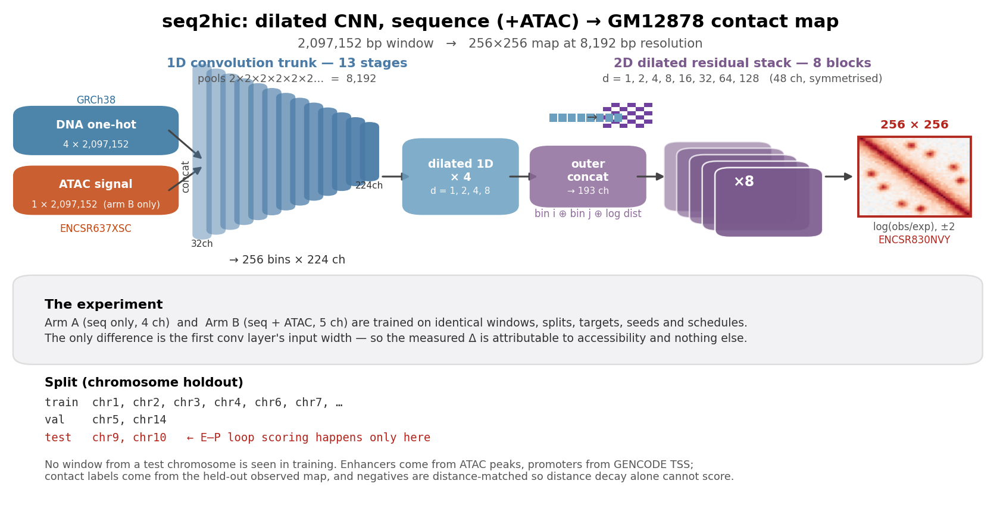
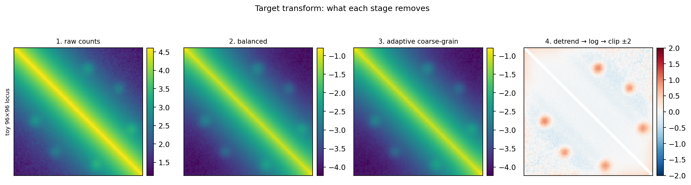

# seq2hic-gm12878

Predicting GM12878 chromatin contact maps from DNA sequence, and measuring how much
chromatin accessibility actually adds.

Two models are trained on identical windows, splits, targets and schedules. The only
difference is the input:

| arm | input | question it answers |
|---|---|---|
| **A** `seq_only` | one-hot DNA (4 × 2,097,152) | how far does sequence alone get you? (Akita-style) |
| **B** `seq_atac` | one-hot DNA + ATAC signal (5 × 2,097,152) | does measured accessibility carry information sequence does not? (C.Origami-style) |

The contribution is the **delta**, not either model on its own: ΔPearson on held-out
contact maps, Δinsulation-score correlation, and ΔAUPRC on enhancer–promoter loop
retrieval over held-out chromosomes.



---

## Data

Both datasets are GM12878, so the accessibility channel is a genuine matched input
rather than a proxy from another cell type.

| accession | assay | lab | role |
|---|---|---|---|
| [ENCSR830NVY](https://www.encodeproject.org/experiments/ENCSR830NVY/) | Hi-C | Aiden, Baylor (series ENCSR392PEL) | **target** — 2D contact map |
| [ENCSR637XSC](https://www.encodeproject.org/experiments/ENCSR637XSC/) | ATAC-seq | Snyder, Stanford (ENCODE4) | **input channel** (signal bigWig) + **enhancer definition** (IDR peaks) |

Auxiliary: GRCh38 primary assembly FASTA, GENCODE TSS annotation.

File URLs are **not hardcoded**. `python -m seq2hic.encode list ENCSR830NVY` queries the
ENCODE REST API and prints every released file with its `output_type`, `file_format`
and assembly, so you pick against ground truth rather than against a stale URL.

---

## Representation

* **Window**: 2,097,152 bp (2^21), stride 262,144 bp during training, non-overlapping at eval.
* **Output grid**: 256 × 256 bins ⇒ **8,192 bp per bin** (2^21 / 2^8).
* **Target transform**: balanced counts → observed/expected against a per-chromosome
  diagonal-decay curve → `log` → clip to ±2 → symmetrize. The first two diagonals are
  masked out of the loss (they are dominated by ligation artefacts).
* **Resolution handling**: ENCODE matrices are stored at standard resolutions (1/5/10 kb),
  not 8,192 bp. Windows are read at the finest available native resolution and
  **area-resampled** onto the 8,192 bp grid. The resampling is exact area-weighted
  averaging, not interpolation — see `targets.py::area_resample`.
* **ATAC channel**: fold-change-over-control bigWig, `log1p`, base-pair resolution,
  concatenated as a fifth input channel.

---

## Model

A pure dilated CNN — no attention, no recurrence.

```
one-hot (+ATAC)  (B, 4|5, 2_097_152)
  └─ stem conv k=11
  └─ 13 × [conv k=5 → BN → GELU → maxpool 2]      2^13 = 8192 bp per bin
  └─ 4 × dilated 1D residual blocks (d = 1,2,4,8)
  └─ 1×1 conv → C1 = 96                            (B, 96, 256)
outer concat: broadcast i and j, + log-distance channel
                                                   (B, 193, 256, 256)
  └─ 1×1 conv → C2 = 48
  └─ 8 × dilated 2D residual blocks (d = 1,2,4,…,128), symmetrized
  └─ 1×1 conv → 1, symmetrize                      (B, 256, 256)
```

Loss: MSE over the upper triangle with `|i-j| >= 2`.

**The block count is not arbitrary.** Each output bin must be able to see both of its
own anchors, so the 2D receptive field has to cover the whole window. With dilations
doubling from 1, `n` blocks reach `1 + 2·(2ⁿ − 1)` bins:

| blocks | receptive field | covers 2.10 Mb window? |
|---|---|---|
| 6 | 127 bins = 1.04 Mb | ✗ |
| 7 | 255 bins = 2.09 Mb | ✗ (just short) |
| **8** | **511 bins = 4.19 Mb** | ✓ |

`figures/fig7_receptive_field.png` is generated from the config and states plainly
whether the current setting covers the window — regenerate it after changing depth,
window size or resolution.

---

## Splits

Chromosome holdout — no window from a test chromosome is ever seen in training, and
windows are cropped so they cannot straddle a split boundary.

```
train  chr1–4, 6, 7, 11–13, 15–22
val    chr5, chr14
test   chr8, chr9, chr10
```

chrX, chrY, chrM and unplaced contigs are excluded. Configurable in `configs/base.yaml`.

---

## Quickstart

```bash
pip install -r requirements.txt

# 0. see what ENCODE actually has for these accessions
python -m seq2hic.encode list ENCSR830NVY
python -m seq2hic.encode list ENCSR637XSC

# 1. download (writes to data/raw, resumable, md5-checked)
python -m seq2hic.encode fetch ENCSR830NVY --output-type "mapping quality thresholded contact matrix"
python -m seq2hic.encode fetch ENCSR637XSC --output-type "fold change over control" --file-format bigWig
python -m seq2hic.encode fetch ENCSR637XSC --output-type "IDR thresholded peaks" --file-format bed
python -m seq2hic.encode genome            # GRCh38 FASTA + GENCODE TSS

# 2. materialise tensors once (targets, ATAC memmaps, window index)
python -m seq2hic.prepare --config configs/base.yaml

# 3. train both arms
python -m seq2hic.train --config configs/seq_only.yaml
python -m seq2hic.train --config configs/seq_atac.yaml

# 4. evaluate + ablation table
python -m seq2hic.evaluate --config configs/seq_only.yaml --split test
python -m seq2hic.evaluate --config configs/seq_atac.yaml --split test
python -m seq2hic.ablation --runs runs/seq_only runs/seq_atac
```

A CPU smoke test that exercises the whole path on synthetic data in about a minute:

```bash
pytest -q                      # shape + invariance tests
python -m seq2hic.train --config configs/smoke.yaml
```

---

## Platform notes

* **`pyBigWig` has no Windows wheel.** `tracks.py` therefore supports three backends —
  `pyBigWig`, the UCSC `bigWigToBedGraph` binary, or a pre-converted `.npy` — and the
  conversion happens once in `prepare`, so the training loop itself needs only numpy.
  On Windows the practical route is the UCSC binary; on Linux/WSL, `pyBigWig`.
* **`.hic` vs `.mcool`.** `cooler` is the first-class path (pure Python, works on Windows).
  `hicstraw` is optional and used only if ENCODE released `.hic` and not `.mcool`.
* **Training is GPU work.** A 2 Mb window at bp resolution through a 13-stage conv tower
  is roughly 11 GB of activations at batch size 1 in fp32. Use `--amp` and expect to want
  ≥24 GB VRAM, or reduce `window_bp` to 2^20 and `n_bins` to 128 for a smaller study.
  The torch install on this machine is CPU-only (`2.10.0+cpu`) — fine for `smoke.yaml`,
  not for a real run.

---

## Layout

```
configs/            base + per-arm + smoke configs
src/seq2hic/
  encode.py         ENCODE REST discovery, resumable download, md5 verification
  genome.py         FASTA → one-hot, chromosome sizes, N-masking
  tracks.py         bigWig → per-chromosome float16 memmap
  targets.py        cooler/hic → O/E log windows on the 8,192 bp grid
  prepare.py        one-shot dataset materialisation
  dataset.py        window index, splits, torch Dataset
  model.py          trunk, outer concat, dilated 2D head
  train.py          loop, AMP, checkpointing, early stop
  metrics.py        map correlation, insulation score, boundary F1
  ep_loops.py       enhancer–promoter pair construction + AUPRC
  evaluate.py       per-chromosome eval report
  ablation.py       arm A vs arm B delta table
tests/
```

---

## Figures

Two kinds, kept strictly apart so nothing can be mistaken for a result.

**Design figures** — generated from the config alone, no training required, and
committed to `figures/`:

```bash
python -m seq2hic.architecture_fig --config configs/seq_atac.yaml --out figures
```

| | |
|---|---|
| `fig0_architecture.png` | full data flow, every number read from the config |
| `fig7_receptive_field.png` | dilation schedule; states whether the 2D stack covers the window |
| `fig8_target_transform.png` | raw counts → balanced → coarse-grained → detrended log(O/E) |



Panel 4 is the point of the whole transform: distance decay is gone, and what
remains is the off-diagonal loop structure the model is actually asked to predict.

**Result figures** — produced from a trained run:

```bash
python -m seq2hic.figures --runs runs/seq_only runs/seq_atac --split test --bin-bp 8192
```

| | |
|---|---|
| `fig1_contact_maps.png` | observed / predicted / difference for best, median and worst held-out windows |
| `fig2_insulation.png` | observed vs predicted insulation profile with called boundaries |
| `fig3_training_curves.png` | loss and validation correlation, both arms |
| `fig4_ep_pr_curve.png` | E–P precision-recall vs the distance-only baseline |
| `fig5_ablation.png` | per-metric Δ with paired bootstrap CIs |
| `fig6_distance_decay.png` | accuracy as a function of genomic separation |

`fig6` is the honesty check: a high overall correlation carried entirely by
short-range contacts, with long-range structure at chance, is the classic way
this class of model looks better than it is.

`figures_smoke/` holds the same figures from the **synthetic** CPU smoke run.
They demonstrate the plumbing works and nothing more — see the README in that
directory.

---

## Reporting

`ablation.py` emits a markdown table and `ablation.json`:

| metric | seq-only | seq+ATAC | Δ |
|---|---|---|---|
| map Pearson (test chroms) | | | |
| map Spearman | | | |
| insulation Pearson | | | |
| boundary F1 | | | |
| E–P loop AUPRC | | | |
| E–P loop AUROC | | | |

Deltas use a **paired** bootstrap over windows — both arms are evaluated on the identical
window list, so pairing cancels the shared between-window variance and gives a much
tighter interval than comparing two independent CIs.

Three reference points are reported alongside the E–P AUPRC, because the number is
meaningless without them:

- **random** = the positive rate (AUPRC's baseline *is* the positive rate),
- **distance-only** = scoring pairs by `−distance`; a model that fails to beat this has
  learned distance decay and nothing else, whatever its map correlation says,
- **observed-map ceiling** = scoring with the true map, i.e. the best achievable given
  how the labels were defined.

## Status

The pipeline runs end to end and is verified by 36 tests plus a synthetic CPU smoke run
(`prepare → train both arms → evaluate → ablation → figures`).

### First real-data run (2026-11-22, Kaggle 2×T4, configs `free_seq_only` / `free_seq_atac`)

Test chromosomes, 114 held-out 2 Mb windows; Δ = paired bootstrap, 1000 resamples.

| metric | seq-only | seq+ATAC | Δ (95% CI) |
|---|---|---|---|
| map Pearson | 0.045 | 0.334 | +0.289 [0.249, 0.334] |
| map Spearman | 0.047 | 0.304 | +0.257 [0.220, 0.297] |
| insulation Pearson | −0.026 | 0.353 | +0.378 [0.313, 0.444] |
| boundary F1 | 0.000 | 0.000 | — |
| E–P loop AUPRC | 0.098 | 0.192 | +0.094 |
| E–P loop AUROC | 0.521 | 0.723 | +0.203 |

E–P reference points: random = 0.091 (positive rate), distance-only = 0.089 AUPRC / 0.499 AUROC.

**Read with these caveats — this is not yet a fair ablation:**

- **The seq-only arm did not train properly.** Validation loss blew up at epoch 3
  (0.12 → 1.34 → 7.61) and early stopping ended it after 5 epochs; its best checkpoint
  is from epoch 1 (val r = 0.07). The gap above therefore mixes "ATAC helps" with
  "seq-only diverged". seq+ATAC trained stably for 17 epochs (best val r ≈ 0.35).
  The seq-only arm needs a rerun with a lower learning rate / tighter clipping before
  the Δ can be attributed to ATAC.
- **Boundary F1 is 0 for both arms**, including one whose insulation tracks the truth
  at r = 0.35 — most likely a boundary-calling / matching bug, not a model result.
- The seq+ATAC arm beats the distance-only E–P baseline (AUPRC 0.19 vs 0.09), so it
  has learned more than distance decay.
- Earlier Kaggle attempts were discarded: forked DataLoader workers shared one pyfaidx
  handle and could read wrong bases (fixed in `95cc1a6`). These numbers are from the
  first run after that fix.

## License

MIT.
